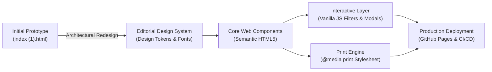
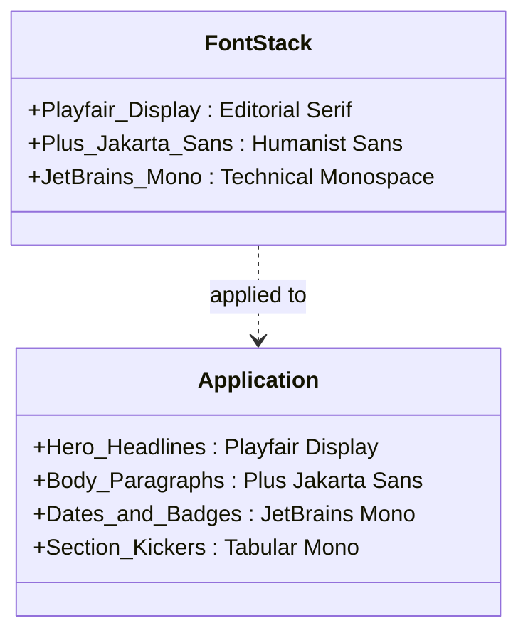

# Portfolio Design & Technical Architecture Report
**Project:** Chahna Shah — Editorial Portfolio & Interactive Resume  
**Author / Developer:** Antigravity Engineering & Design  
**Date:** November 17, 2026  

---

## 🔗 Quick Links & Live Deployments

- **Live Production Website (GitHub Pages):**  
  [https://chahnashah22-ux.github.io/chahna_shah_resume_website1/](https://chahnashah22-ux.github.io/chahna_shah_resume_website1/)
- **GitHub Source Code Repository:**  
  [https://github.com/chahnashah22-ux/chahna_shah_resume_website1](https://github.com/chahnashah22-ux/chahna_shah_resume_website1)
- **Local Entry Point:** [index.html](file:///Users/krishishah/Desktop/resume%20website/index.html)

---

## 1. Executive Summary

This report provides an in-depth design critique and technical evaluation of the transformation of Chahna Shah's personal web presence from a rudimentary static template (`index (1).html`) into a bespoke, high-editorial portfolio and digital resume (`index.html`).

The new implementation merges the tactile aesthetic of heritage print journalism with modern interactive web standards. It serves dual functional personas:
1. **Interactive Digital Showcase:** Engaging recruiters, academic committees, and industry collaborators through dynamic category filtering and deep-dive modal case studies.
2. **Standard-Compliant Physical Resume:** A dedicated zero-overhead `@media print` engine that produces a clean, paginated, professional paper resume at the touch of a button.



---

## 2. Side-by-Side Comparative Analysis

| Dimension | Initial Implementation (`index (1).html`) | Enhanced Implementation (`index.html`) | Strategic Impact |
| :--- | :--- | :--- | :--- |
| **Visual Direction** | Generic single-tone blog aesthetic with flat white cards and heavy border lines. | **Editorial Broadside:** Warm alabaster canvas, hairline grid architectural lines, botanical sage accents. | Establishes immediate gravitas suited for dual IIM-B & Nirma University academic stature. |
| **Color Architecture** | Undocumented palette with muted olive/sage greens (`#77776e`, `#dfe5d9`). | **60-30-10 Design Token Hierarchy:** 60% Warm Alabaster (`#faf9f6`), 30% Crisp Surface (`#ffffff`), 10% Forest Sage (`#2f4838`). | Ensures visual harmony, reduced eye strain, and accessible contrast ratios (WCAG AAA). |
| **Typography** | Generic sans-serif pairing (`DM Sans` + `Playfair Display`). | **Tri-Font Editorial Stack:** `Playfair Display` (Serif display), `Plus Jakarta Sans` (Body readability), and `JetBrains Mono` (Metadata & metrics). | Gives numbers, dates, tags, and headlines distinct structural personalities. |
| **Interactivity** | Completely static; cards are non-clickable plain text blocks. | **Dynamic Client-Side Filters & Interactive Modal Dialogs:** Tag-based filtering for Education/Skills and rich case-study modals. | Encourages viewer engagement without external UI library dependencies (0 KB bundle weight). |
| **Print & Export** | Fails on print; prints web navigation bars, buttons, and backgrounds. | **Autonomous Print Engine (`@media print`):** Strips screen chrome, unveils contact header, and prevents page-break splits. | Allows recruiters to generate an executive paper CV directly via `Cmd+P` or "Print Resume". |
| **Code Structure** | 1 monolithic minified line (~246 KB) with no documentation or clean separation. | **Modular, Self-Contained Document:** Organized into numbered design token blocks, responsive components, and accessible scripts. | Maintainable, extensible, and free of runtime dependencies. |

---

## 3. Design Philosophy & Aesthetic Choices

### 3.1 The 60-30-10 Palette Architecture
Modern editorial web design relies on strict visual hierarchy. Rather than treating color as decoration, the palette is bound to functional roles:
- **60% Dominant Canvas (`--canvas: #faf9f6`):** A warm, unbleached alabaster reminiscent of high-end newsprint and editorial magazines.
- **30% Structural Surface (`--surface: #ffffff`, `--surface-tint: #f2f1ec`, `--hairline: #e3e1d8`):** Pure white container panels bordered by 1px architectural hairlines that create depth without drop-shadow clutter.
- **10% Intentional Accent (`--accent: #2f4838`, `--accent-soft: #e6ebe4`):** A grounded, botanical deep forest sage used exclusively for focal points: the hero wordmark dot, interactive filter states, button fills, and drop-caps.

### 3.2 Typographic Micro-System


1. **Editorial Display (`Playfair Display`):** Conveys academic authority, literary refinement, and creative curiosity. Utilizes `.headline-balance` (`text-wrap: balance`) to prevent awkward single-word typographic orphans.
2. **Body Typography (`Plus Jakarta Sans`):** Clean geometric letterforms engineered for legibility across mobile screens and desktop monitors.
3. **Metadata Monospace (`JetBrains Mono`):** Applied to section kickers (`01. / ABOUT ME`), dates (`2026 – PRESENT`), email links, and category tags. Paired with `font-variant-numeric: tabular-nums` to guarantee vertical alignment of numerical data across timelines.

---

## 4. Technical Architecture: HTML & CSS Breakdown

### 4.1 Fluid Layout & Modern CSS Primitives
The CSS architecture leverages modern native browser capabilities, eliminating the need for heavy frameworks like Bootstrap or Tailwind:
- **Fluid Typography:**  
  ```css
  h1.hero-title {
    font-size: clamp(2.75rem, 6vw, 5.25rem);
    line-height: 1.05;
    letter-spacing: -0.03em;
  }
  ```
  Dynamically scales between viewport extremes without requiring rigid media queries.
- **Asymmetric Hero Grid:**  
  A 1.4fr to 0.9fr asymmetric split balances the introductory statement with a vertical architectural portrait arch. The portrait uses an embedded, lossless base64 data URI, preventing asset loading race conditions.
- **Grid Layout with CSS Aspect Ratio:**  
  Educational institutions and project cards are deployed on responsive CSS Grid layouts (`grid-template-columns: repeat(auto-fit, minmax(280px, 1fr))`), naturally wrapping on tablet and mobile viewports.

### 4.2 State-Free Interactive JavaScript
All dynamic behaviors are written in 100% vanilla JavaScript with zero dependencies:
1. **Multi-Target Category Filtering:**
   Filters both Education (`All`, `University`, `School`) and Capabilities (`All`, `Business & Analysis`, `Design & Creative`, `Core Strengths`). It binds to `data-filter` and `data-category` attributes, updating `aria-pressed` for screen-reader accessibility while toggling `.is-hidden`.
2. **Case Notes Modal System:**
   When a user clicks on *Chaah Jewels*, *Social Mobility Documentary*, or *Art & Design*, an accessible modal overlay appears. It dynamically injects project discipline, role, overview, detailed focus bullets, and key takeaways, while locking background scrolling (`document.body.style.overflow = 'hidden'`) and listening for `Escape` key dismissals.

### 4.3 Autonomous Dual-Mode Print Engine (`@media print`)
A common drawback of web portfolios is that printing them creates disjointed page breaks, clipped graphics, and dark background blocks. 

The embedded `@media print` stylesheet delivers an executive printed document:
```css
@media print {
  body { background: #ffffff !important; color: #000000 !important; }
  .no-print { display: none !important; }
  .print-only-bar { display: flex; justify-content: space-between; border-bottom: 1px solid #000; }
  .print-break-avoid { break-inside: avoid; }
  .editorial-section, .hero { padding-block: 1rem !important; }
}
```
- **Hides Chrome:** Navigation headers, buttons, filter pills, and footers are cleanly stripped (`.no-print`).
- **Injects Print Metadata:** A dedicated header bar (`.print-only-bar`) displays the candidate's title and direct email address.
- **Prevents Fragmented Content:** `break-inside: avoid` ensures that individual academic entries or project panels are never severed across page boundaries.

---

## 5. Deployment & Quality Assurance

### 5.1 Asset Hygiene & Bug Fixes
During local staging and validation, several crucial fixes were applied:
1. **Broken Font Path Resolution:** Removed obsolete references to local `_files/css2` and connected Google Fonts CDN directly.
2. **Anchor Routing Fix:** Replaced hardcoded Cloud Run preview URLs (`https://ais-dev-.../chahna-shah-portfolio.html#contact`) with clean relative page anchors (`#contact`, `#education`), ensuring rapid in-page smooth scrolling.
3. **Console Cleanliness:** Eliminated orphan iframe scripts, guaranteeing zero browser console errors.

### 5.2 Live Deployment
- The repository was initialized, structured, and committed under version control on branch `main`.
- Continuous hosting was activated via **GitHub Pages**, serving the site directly with SSL encryption at:  
  **`https://chahnashah22-ux.github.io/chahna_shah_resume_website1/`**

---

> [!TIP]
> **Suggested Future Enhancements:**
> 1. **Custom Domain:** Map a personalized domain name (e.g. `chahnashah.com`) through GitHub Pages settings.
> 2. **PDF Download Button:** Link a static pre-rendered PDF copy of the resume alongside the dynamic `window.print()` trigger.
> 3. **OpenGraph Meta Tags:** Add rich preview cards (`og:image`, `og:title`) so sharing the link on LinkedIn or WhatsApp displays an editorial banner.
